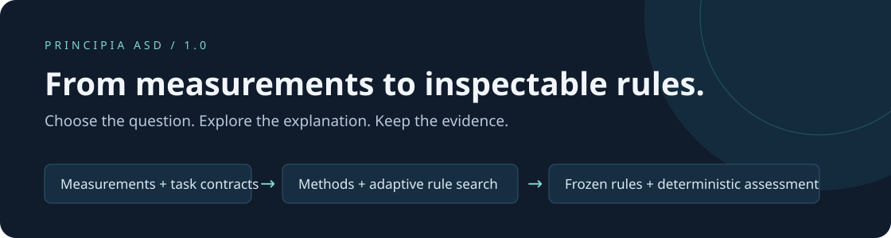
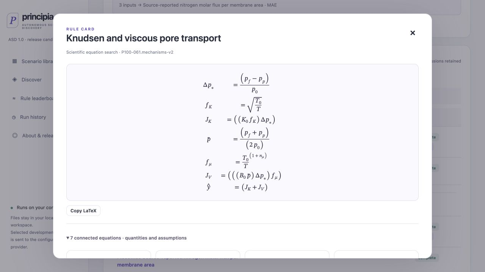
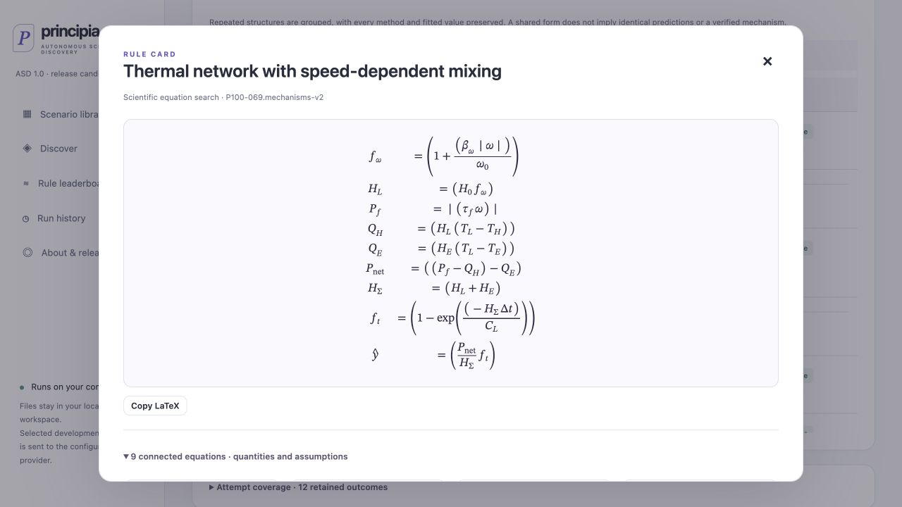

<p align="center"></p>

<p align="center"><strong>Scientific rule discovery, with the reasoning made inspectable.</strong></p>
<p align="center">
  <a href="https://atlas.chipflow.net/web/asd-test/">Explore the live library</a> ·
  <a href="#start-locally">Start locally</a> ·
  <a href="docs/METHODS.md">Methods</a> ·
  <a href="docs/EVALUATION.md">Evaluation</a> ·
  <a href="REPRODUCIBILITY.md">Reproducibility</a>
</p>
<p align="center"><b>1.0.0rc6</b> · 47 scientific scenarios · 51 task leaderboards · 11 connected-equation examples</p>

Principia ASD is an open framework for **Autonomous Scientific Discovery**: choose a scientific question, investigate it with interchangeable methods, and examine the resulting rules against a declared evidence contract.

A low prediction error is useful. A scientific explanation also needs quantities with meaning, explicit assumptions, and a test that could expose its failure. Principia ASD brings these elements into the same workflow: compact datasets, executable mathematics, traceable experiments, and task-specific comparisons.

## From a fitted expression to an inspectable scientific model

Rules can be **connected systems of equations**. Intermediate quantities have units and interpretations; parameters are shared explicitly; every equation executes. A gas-transport model can separate molecule-wall and viscous flux. A thermal model can connect frictional power, heat loss, thermal storage, and temperature change.


*An actual Rule Card: pressure and temperature determine separate transport contributions, then combine into predicted molar flux. Symbols, fitted values, assumptions, and held-out performance are inspectable below the equations.*


*An actual thermal-network candidate: mechanical power and competing heat pathways feed a finite-horizon temperature response. Both screenshots show sourced constitutive hypotheses fitted by Scientific equation search, not newly discovered physical laws.*

The interface groups repeated mathematical structures while preserving every method, fitted state, and outcome. It does not turn a polynomial into a mechanism by giving its terms new names.

## One platform, several ways to investigate

| Capability | What it makes possible |
|---|---|
| **Scenario library** | Understand the measurements, source, units, partitions, and task before running an experiment. Add your own input–output combination or local numeric CSV. |
| **Method workbench** | Compare numerical controls, direct proposals, feedback refinement, program search, and adapted research agents under explicit budgets. Unsupported capabilities fail visibly. |
| **Equation discovery** | Compose, fit, and revise typed equations with reusable primitives, meaningful intermediate quantities, and shared parameters. |
| **Rule Cards** | Read typeset mathematics; inspect parameter values, physical assumptions, complexity, test coverage, perturbation diagnostics, and the ASD recipe. |
| **Task leaderboards** | Compare accuracy, simplicity, and stability within the same task. Preserve failures and distinguish independent structures from repeated fits. |
| **Reproducible records** | Follow immutable contracts, source hashes, frozen submissions, execution receipts, and deterministic evaluations. |

**Adaptive Primitive Search (APS)** explores reusable primitives and formula patterns. **Adaptive Equation Discovery (AED)** extends this approach to equation graphs: a planner and proposal model suggest hypotheses; local code fits and validates them; a critic examines development diagnostics; an interpreter records the evidence. Model roles and exact identifiers are configurable. These are hosted methods, not synonyms for Principia ASD.

**Scientific equation search** provides a complementary, non-LLM route: compare explicitly sourced constitutive families with train-only fitting and development selection. Keeping the origin of a hypothesis visible is as important as displaying its formula. [Method definitions and adaptation boundaries →](docs/METHODS.md)

## Explore the evidence

The release includes **799 frozen rule submissions across 51 tasks in 47 scenarios**. Eleven scenarios provide connected-equation tasks, spanning atmospheric radiation, resin rheology, polymer relaxation, cure kinetics, vapor transport, learning dynamics, battery relaxation, porous membranes, gearbox heating, biosensors, and soil respiration.

| Evidence collection | Tasks | Retained attempts | Rule submissions |
|---|---:|---:|---:|
| Frozen primary comparison | 40 | 520 | 693 |
| First connected-equation collection | 3 | 15 | 19 |
| Expanded mechanism studies | 8 | 96 | 87 |
| **Combined public inventory** | **51** | **631** | **799** |

The supplemental studies are engineering cohorts, kept separate from the primary comparison. Some scenarios contain both a historical task and a newer equation-system task; their contracts and leaderboards remain distinct. Counts describe retained artifacts, not independent discoveries or universally successful models.

In the eight expanded studies, development-selected scientific equation models have lower observed held-out loss than every tested numerical control on five tasks. Simpler controls remain stronger on others. An agent-proposed gearbox revision improves development fit but worsens transfer; that failure is retained. [Comparison report](docs/mechanism-review/index.html) · [Machine-readable results](docs/mechanism-review/comparison.json) · [Scientific interpretation and limitations](docs/LOCAL_ITERATION_2026-10-16.md)

## Start locally

Browse the [public library](https://atlas.chipflow.net/web/asd-test/) without installing anything. To run discovery on your own computer, download its companion bundle, extract it, and enter `public-release`. Alternatively, clone this repository. Python **3.11+** is required.

```bash
python3 -m venv ~/.principia-asd-venv
~/.principia-asd-venv/bin/pip install .
~/.principia-asd-venv/bin/principia-asd companion --bundle-root .
```

Open **http://127.0.0.1:8150/** and keep the terminal running.

1. Choose **Scenario library → Try it yourself**, or import a local grouped numeric CSV.
2. Inspect the task card and select a method. Numerical controls need no API key.
3. For LLM methods, open **API settings**. Add your SiliconFlow key, select or edit exact model identifiers and dated prices, then explicitly check capabilities. Saving profiles and browsing the catalog do not generate model responses; capability probes are billed.
4. Run discovery, inspect the Rule Cards, and export your results. Personal runs do not overwrite the shared library.

Use `--port 8152` if the default port is occupied. Use `--workspace /your/private/folder` for a separate workspace. Standard numerical methods run on macOS and Linux; generated-code workers require the tested macOS sandbox and refuse unsupported platforms. [Installation, privacy, and hosting →](docs/DEPLOYMENT.md)

## Public evidence. Local experimentation.

The hosted website is a **static, read-only publication**. It has no data-upload endpoint, user discovery service, or shared API key. Your local companion holds your folders, credentials, jobs, and newly generated results. When you choose an LLM method, selected development context travels directly from your companion to your configured provider.

Each workspace has its own execution and cost records. Visitors cannot overwrite one another's results or the published leaderboard. Protected example-test targets are never in the public download: new example runs can inspect development results, but final private-test scoring requires an authorized evaluator. Local imports create their own local partitions.

```text
public-release/                         # This repository and downloadable companion
  src/principia_asd/                    # Package, CLI, methods, evaluation, local UI
  data/  leaderboards/                  # Frozen primary collection
  collections/                         # Additional data and results, independently versioned
  COLLECTIONS.json                      # Relative paths and immutable edition bindings
  docs/  tests/  configs/               # Documentation, verification, and policies

private-evaluator/                     # Separate operator delivery; never public or in Git
  targets/                             # Primary protected outcomes
  collections/<id>/targets/            # Matching extension outcomes
```

## How results are judged

A task freezes permitted inputs, output, partition policy, coverage, and evaluation rules. Discovery uses training and development evidence; submissions freeze before final assessment. **Final numerical evaluation makes no LLM calls.**

- **Accuracy:** the task's loss, coverage, and justified subgroup or uncertainty analysis.
- **Simplicity:** expanded operators, free parameters, preprocessing, and learned state. Naming a complex component a “kernel” does not erase its complexity.
- **Stability:** perturbations within a declared domain. When the physical perturbation model is uncertain, sensitivity is diagnostic rather than a ranking criterion.

There is no default universal scientific score. Numerical rankings and any strong-model scientific review are separate. Review cannot certify originality, causality, or practical impact. [Evaluation contract →](docs/EVALUATION.md)

## Research status and contribution

This release candidate establishes a working discovery framework and a retrospective evidence collection. **Independent discovery, prospective validation, mechanism identification, and external scientific review remain unestablished.** Six historical preparation defects, three unfinished source reviews, and incomplete learned-state accounting for at least 65 historical rules remain visible in the associated records. Frozen publication flags are preserved; owner-authorized preview deployment is not a certification of third-party redistribution rights.

Code is **MIT**. Data and upstream adaptations retain their own terms. See [provenance](PROVENANCE.md), [data licenses](data/LICENSES.md), [release scope](docs/RELEASE_SCOPE.md), and the source records in each collection before redistributing data or making scientific claims.

Contributions are most valuable when they make an explanation easier to challenge: a better-defined task, a stronger matched control, a faithful method adapter, or a reproducible counterexample. A few dozen well-supported scenarios are more useful than a nominal benchmark size. [Contribution guide →](CONTRIBUTING.md)
